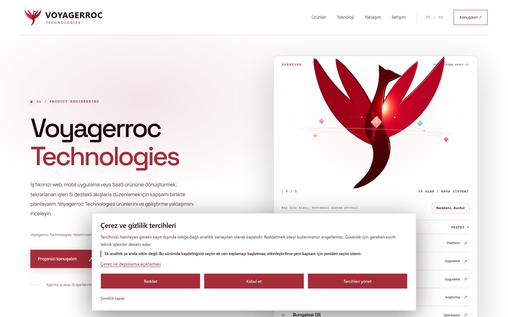
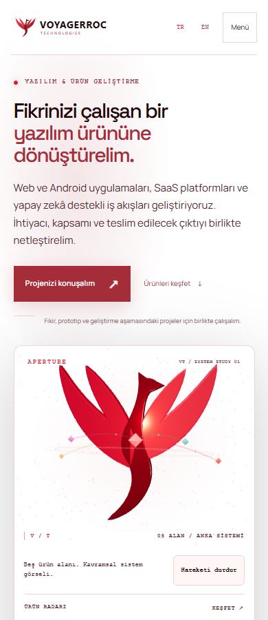

# Voyagerroc Technologies

Corporate website for an independent software engineering ecosystem spanning personal finance, Bluetooth communication, evidence-led recruitment, research, and operations.

**Website:** [https://voyagerroctechnologies.com](https://voyagerroctechnologies.com)  
**Cloudflare Origin:** [https://voyagerroc-technologies.voyagerroc.workers.dev](https://voyagerroc-technologies.voyagerroc.workers.dev)  
**Founder & Operator:** [Erol Taşcı](https://voyagerroctechnologies.com/erol-tasci/)  
**LLM / AI Manifest:** [https://voyagerroctechnologies.com/llms.txt](https://voyagerroctechnologies.com/llms.txt)  

The website is independently hosted on **Cloudflare Workers Static Assets** with zero runtime npm dependencies, strict origin isolation, custom domain bindings, and automated security headers.

---

## 🎨 New Visual Identity & Phoenix Theme

The website has been completely reimagined with a high-contrast, clean **Phoenix (Anka Kuşu)** visual identity:
- **Color Palette:** Pure White (`#FFFFFF`) surface with Deep Burgundy (`#20070B`) typography, warm rose panels (`#FFF7F6`), and vivid Crimson / Fire Red accents (`#C82A3A`, `#A52D3A`).
- **Typography:** Self-hosted `Space Grotesk` (display headings) and `Manrope` (body copy) with zero Google Fonts runtime dependencies.
- **Brand Mark:** Custom vector Phoenix Anka symbol and multi-resolution icon kit:
  - Multi-resolution `favicon.ico` (16x16, 32x32, 48x48)
  - 48x48, 96x96, and 192x192 PNG favicons (Googlebot-Image 48px standard)
  - 180x180 Apple Touch Icon
  - 512x512 high-resolution Schema.org brand logo
  - 1200x630 white/crimson OpenGraph & Twitter social card

---

## 🚀 Core Web Vitals & Performance Engineering

- Performance and accessibility measurements apply only to the measured build and environment; see `docs/AUDIT-REMEDIATION-2026-11-05.md` for current checks.
- **APERTURE autoplay:** The Three.js WebGL module loads on entry on phones, tablets and desktop. Responsive framing preserves the wings and orbit; pause/resume remains available. Performance must be measured for this autoplay build.
- **Sub-second LCP:** High-priority `<link rel="preload">` ensures the hero Aperture poster (`assets/aperture-static.webp`) paints immediately on first byte delivery.
- Images reserve dimensions; layout shifts and performance must be measured for each release.

---

## 🤖 GEO (Generative Engine Optimization) & Entity Disambiguation

Configured for next-generation AI search engines (Google Gemini / AI Overview, OpenAI ChatGPT, Anthropic Claude, Perplexity):
- **`/llms.txt` and `/llms-full.txt` Manifests:** Structured Markdown documentation following the `llmstxt.org` standard with verified links.
- **Explicit Entity Disambiguation:** Strictly distinguishes **Voyagerroc Technologies** (independent Turkish software brand founded by Erol Taşcı) from US-based aerospace/defense corporation **Voyager Technologies (Voyager Space)** across Schema.org `Brand`, `FAQPage`, and bilingual documentation.
- **AI Crawler Whitelist in `robots.txt`:** Fully open to `Google-Extended`, `GPTBot`, `ClaudeBot`, `PerplexityBot`, and `Applebot-Extended`.
- **Knowledge Graph Schema:** Validated JSON-LD graph linking `WebSite`, `Brand`, `Person` (Erol Taşcı), `AboutPage`, and `FAQPage`.

---

## 📱 Featured Products & Systems

1. **PayRadar** (`/urunler/payradar/`): Android native (Kotlin, Jetpack Compose, Room, Biometrics) payment, subscription, and instalment tracker; the former web app is retired with Material 3 Phoenix UI and on-device privacy.
2. **LaserDeck PTT** (`/urunler/laserdeck/`): Offline peer-to-peer Bluetooth Push-To-Talk, voice call, messaging, and photo transfer application for Android devices without internet or cell towers.
3. **Evidence Intelligence Platform (EİP)** (`/urunler/eip/`): Candidate and skill evaluation platform bringing portfolios, verified documents, and candidate-employer interactions into one context.
4. **Pharos Onion Researcher** (`/urunler/pharos/`): Self-hosted hybrid search (BM25 + vector), infrastructure correlation, and historical change analysis platform.
5. **Bungalow OS** (`/urunler/bungalow/`): Facility operations, reservation management, and human-in-the-loop AI approval workflows.
6. **Tabela** (`/urunler/tabela/`): Open web application for football fixture tracking, match insights, and probabilistic score predictions.

---

## 📸 Preview

### Desktop View


### Mobile View


---

## 🛠️ Run Locally

Requires Node.js 20.18.1 or later:

```sh
npm ci
npm run build
npm run dev
```

Open `http://localhost:8890`.

### Pre-deployment Validation

All pull requests and deployments must pass the five rigorous verification suites:

```sh
npm run predeploy
```

- `check`: JavaScript syntax and AST validation across all modules.
- `check:edge`: Cloudflare Worker redirects, method gates, and security header isolation.
- `check:telemetry`: Privacy, GPC, default-off consent gates, and data minimisation.
- `check:search`: 27 sitemap pages, canonical URLs, CSP hash integrity, and entity separation.
- `check:security`: Secret scanning across 150+ repository files (0 leaks allowed).

---

## ☁️ Deployment

Deployments are executed manually via Wrangler:

```sh
npx wrangler login
npm run deploy
```

---

## ⚖️ Privacy and Legal Notices

The legal centre is served at `/yasal/`, containing static notices for KVKK, privacy, browser storage, terms of use, intellectual property rights, data subject requests, and operator contact details.

**Contact:** [erol@voyagerroctechnologies.com](mailto:erol@voyagerroctechnologies.com)
