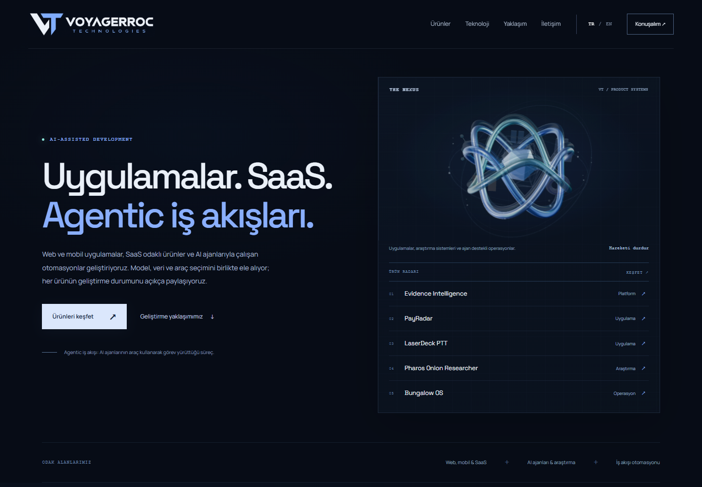

# Voyagerroc Technologies

Corporate website for a product ecosystem spanning evidence-led recruitment, personal finance, Bluetooth communication, research and operations.

**Website:** https://voyagerroctechnologies.com  
**Cloudflare origin:** https://voyagerroc-technologies.voyagerroc.workers.dev

The website runs independently on **Cloudflare Workers Static Assets** with a small stateless HTTPS/canonical-host guard. It does not require OpenAI Sites, an OpenAI account, or an AI API key. All runtime scripts, fonts and 3D assets are served from the same origin.

## What is included

- Turkish and English content, project search, filters and product detail dialogs.
- Featured products: EIP, PayRadar, LaserDeck PTT, Pharos Onion Researcher and Bungalow OS.
- A native-scroll product story linked to APERTURE: one procedural Three.js sculpture with five product domains.
- Mobile layouts, keyboard navigation, motion pause, reduced-motion support and a static WebGL fallback.
- Android test links for EIP, PayRadar and LaserDeck. Test links do not imply a public production release; eligibility is managed by each application.

Some product visuals are explicitly labelled schematic or use sample data. Product statuses describe current scope rather than claiming every workflow passed end-to-end testing.

## Run locally

Install Node.js 20.18.1 or later, then:

```sh
npm ci
npm run build
npm run dev
```

Open http://localhost:8890. The static files are in `dist/`; the application is static. The build regenerates product pages, structured data and security headers. Use an HTTP server rather than opening `index.html` directly because the 3D scene uses JavaScript modules.

```sh
npm run check
```

This checks JavaScript syntax. Browser checks should also cover both languages, mobile navigation, all five story steps, product dialogs, reduced motion and WebGL failure. No real-device FPS or Lighthouse score is claimed.

## Deploy to your own Cloudflare account

1. Change `name` in `wrangler.jsonc` to a unique Worker name.
2. Remove `routes`, or replace the hostname with a domain you control in an active Cloudflare zone. Set `vars.CANONICAL_ORIGIN` to your real HTTPS deployment URL.
3. Replace company content, branding, contact addresses, canonical/social URLs, `robots.txt` and `sitemap.xml` for your deployment.
4. Authenticate and deploy:

```sh
npx wrangler login
npm run deploy
```

For a first deployment, omit `routes`, set `CANONICAL_ORIGIN` to your Worker HTTPS URL, and verify it before adding a custom domain. A `custom_domain: true` route lets Cloudflare manage the Worker domain binding and certificate. Preserve unrelated DNS and email records. OpenAI verification TXT records and OpenAI Sites A targets are not used by this deployment.

Deployments are manual from the CLI; this repository does not configure automatic GitHub deployment or require a stored API token.

## Project structure

```text
dist/
  index.html             Page structure and static story content
  app.js                 Languages, search, filters and product dialogs
  motion.js / motion.css Scroll story and progressive motion
  scene.js / aperture.js Procedural five-domain sculpture
  data/projects.js       Curated public product data
  assets/                Images, logo, icons and self-hosted fonts
  vendor/                Three.js modules and license
brand/                   Separate master PNG logo copy
wrangler.jsonc           Cloudflare static deployment and custom domain
```

The logo PNG is a raster brand asset, not a vector master. Fonts and Three.js retain their included upstream license files. No general open-source license is granted for the original code or brand assets in this repository. Replace Voyagerroc branding and product content before publishing a derivative site.

**Contact:** voyagerroc@voyagerroctechnologies.com

## Preview



[Mobile preview](docs/preview-mobile.png)

## Development dependency note

The deployed site has no npm runtime dependencies. Miniflare’s Undici dependency is overridden to patched `7.30.1`; a clean install and full npm audit reported zero known vulnerabilities on 25 October 2026. Keep the pinned tooling under review. See [security and SEO notes](docs/SECURITY-AND-SEO.md) for verification scope and account-level responsibilities.

## Legal content and privacy controls

The legal centre is served at `/yasal/`, with static Turkish notices for KVKK, privacy, browser storage, terms, intellectual property, data requests and operator contact. It covers this portfolio site, not all linked applications. The operator identity appears only where the legal notices require it; the main page uses the brand name.

Edit `content/legal.mjs`, then run `npm run build` to regenerate legal/product pages, the sitemap and CSP hashes. The deploy script runs generation and syntax checks first. Do not copy these identity-specific notices unchanged to another business, or treat their presence as a compliance certification. Provider transfer safeguards, actual retention settings, contact-information duties and rights/permissions require separate operational verification.

`dist/_headers` applies no-transform to suppress automatically injected browser measurement, restricts scripts and connections to the same origin, and adds security/privacy headers. Only sessionStorage is used for an explicitly selected language; the former localStorage key is removed. The storage notice provides a targeted clear button. No consent-acceptance wall, advertising tracker or marketing form is added. Reassess policies and consent before adding any optional analytics, embeds, accounts, forms or payments.

## Developer collaboration scope

The redundant footer branding/domain/social block was removed. `/yasal/isbirligi/` describes prospective collaboration for the operator's own projects; it is linked from the company section and legal navigation. It does not launch a vacancy, applicant pool, paid intermediary service or CV form. Actual worker classification, tax/social insurance duties, project terms and written IP arrangements remain separate from this general notice. No blanket freelancer exemption or automatic rights transfer is asserted.

## Search and editorial configuration

Five featured products have crawlable pages at `/urunler/{id}/`. The homepage includes WebSite/Brand/ItemList structured data, canonical/social metadata and direct product links. The alternate Workers hostname and HTTP requests redirect permanently to the canonical HTTPS host. See [security and SEO](docs/SECURITY-AND-SEO.md) and [editorial direction](docs/VOICE.md). Public terminology uses **Si** at the owner’s request; it does not claim achieved superintelligence.

## Privacy choices and logs

All pages include first-party accept/reject/settings controls. Optional analytics is **inactive pending transfer and operational verification**; preview choices do not permit later activation. Minimized custom security logs are separate, with raw invocation logging and traces disabled. The prepared optional endpoint stays closed without deployment flags, a new consent version, visitor permission and a rate limiter. See [privacy operations](docs/PRIVACY-OPERATIONS.md). Run `npm run check:telemetry` for the consent and minimisation checks.
